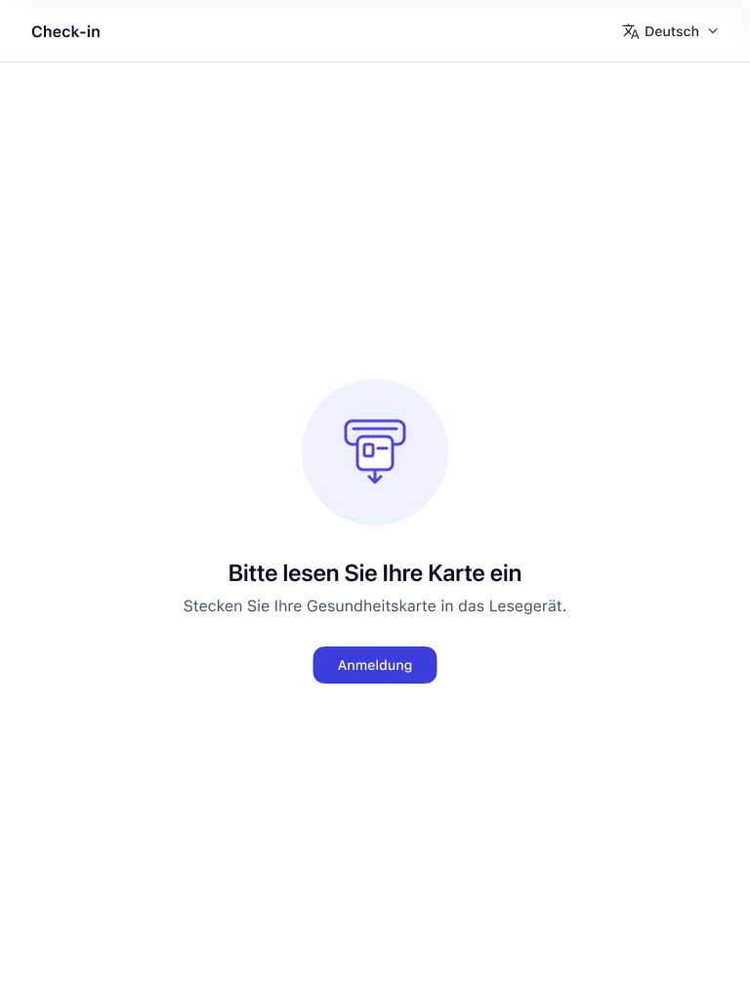
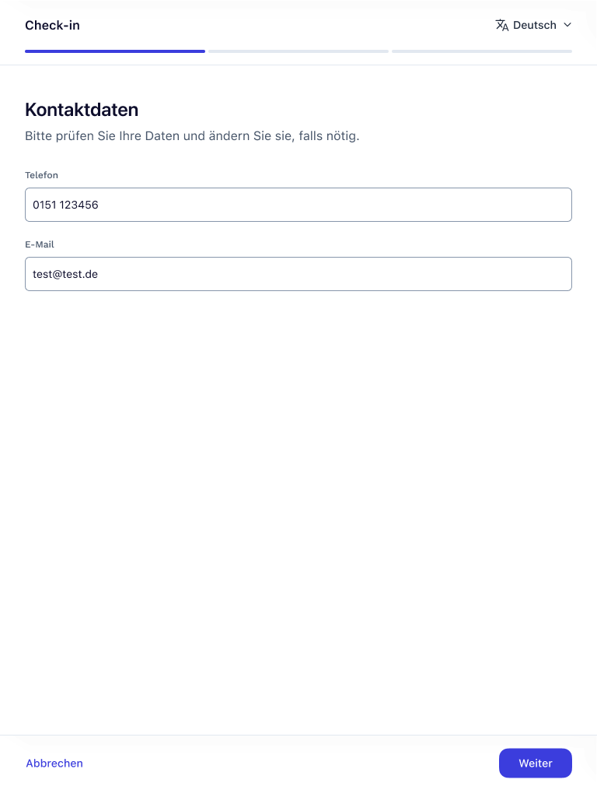
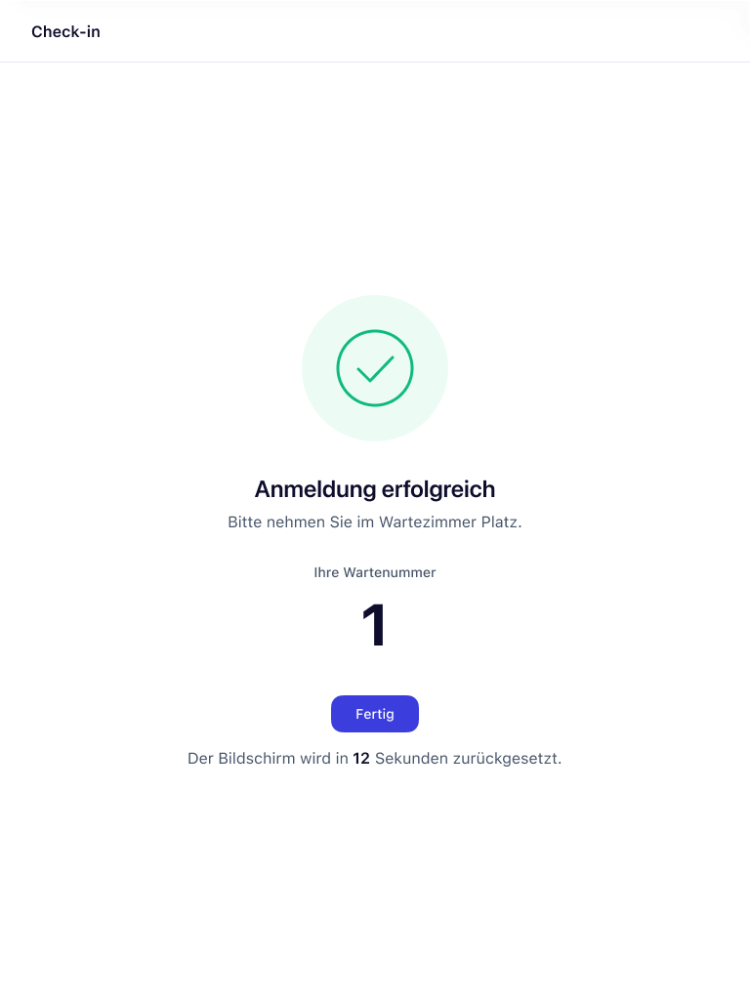

# Quincy QCheckIn – Styleguide für die Webapp

**Stand:** 20. November 2026 · **Referenzgröße:** 768 × 1024 px (Tablet/Kiosk) · **Sprache:** Deutsch als Ausgangssprache

Dieser Guide beschreibt die visuelle Sprache und die Bedienmuster der Patientenerfassung. **Figma-Wert** bezeichnet einen gemessenen Wert aus den Entwürfen; **Umsetzungsregel** eine bewusste Entscheidung für eine robuste Webapp. Die PNGs in [`drafts/`](drafts/) sind die visuelle Referenz. Die zugehörigen `SOURCE*.md`-Dateien dokumentieren die Messungen und spätere Abweichungen.

**Figma-Datei:** [Quincy · Patient check-in](https://www.figma.com/design/NW1VqaB6ud5AGCCLOlWnW3/Quincy-%C2%B7-Patient-check-in?node-id=22-834). Die lokalen PNGs wurden am 27./28.10.2026 exportiert; die Figma-Datei meldete beim API-Abruf am 20.11.2026 eine letzte Änderung vom 09.11.2026. Die unten genannten Maße stammen primär aus den dokumentierten Frames; Typografie und Geometrie des verlinkten Wartezustands wurden erneut per API geprüft.

## 1. Gestaltungsprinzipien

- **Eine Aufgabe pro Ansicht.** Eine klare Überschrift, eine kurze Handlungsanweisung und höchstens eine hervorgehobene Hauptaktion.
- **Ruhe und Verlässlichkeit.** Weißraum, dunkle Schrift und zurückhaltende Konturen tragen die Oberfläche. Indigo markiert Fortschritt, Auswahl und Aktionen.
- **Kiosk zuerst.** Bedienelemente müssen mit dem Finger erreichbar sein; Formulare bleiben bei längeren Inhalten scrollbar, während die Aktionen sichtbar bleiben.
- **Status eindeutig benennen.** Warten, Erfolg, fehlender Termin und Sendefehler erhalten eigene Ansichten mit verständlichem nächsten Schritt.
- **Sprache vor und während der Eingabe erreichbar.** Der Sprachwechsel sitzt auf den interaktiven Screens rechts im Kopfbereich und ändert nicht die aktuelle Aufgabe.

## 2. Visuelle Referenzen

| Start | Formular | Status |
| :---: | :---: | :---: |
|  |  |  |

| Ansicht | Entwurf |
| --- | --- |
| Karte einlesen und Sprachmenü | [Karte einlesen](drafts/01-karte-einlesen.png) · [Sprachmenü](drafts/01-sprachmenue.png) |
| Kein Termin | [Fehlender Termin](drafts/01b-kein-termin.png) |
| Kontaktdaten | [Kontaktdaten](drafts/02-kontaktdaten.png) |
| Anamnese | [Viewport](drafts/03-anamnese.png) · [gesamte Seite](drafts/03-anamnese-lang.png) |
| Zustimmung | [ohne Unterschrift](drafts/04-zustimmung.png) · [unterschrieben](drafts/04b-zustimmung-unterschrieben.png) |
| Senden | [Wartezustand](drafts/04c-wird-gesendet.png) · [Sendefehler](drafts/04d-senden-fehlgeschlagen.png) |
| Bestätigung | [Erfolg](drafts/06-bestaetigung.png) · [Countdown-Komponente](drafts/06-countdown.png) |

## 3. Farben

Die Namen sind für die Webumsetzung vergeben; die Hexwerte stammen aus den Figma-Messungen in `drafts/SOURCE*.md`. Die passenden CSS-Variablen stehen in [`tokens.css`](tokens.css).

| Rolle | Wert | Einsatz |
| --- | --- | --- |
| Fläche | `#FFFFFF` | Seitenhintergrund, Karten, Eingaben |
| Haupttext | `#0E0E2C` | Überschriften, Werte, wesentliche Informationen |
| Begleittext | `#475569` | Erklärungen, Feldlabels, Metadaten |
| Primäraktion | `#3B3DDD` | Hauptbutton, Fortschrittsbalken |
| Illustrations-Indigo | `#4F46E5` | Linienicons und Wartebogen |
| Auswahlfläche | `#EEF2FF` | Gewählte Option, neutrale Statusillustration |
| Auswahltext | `#3730A3` | Text einer gewählten Option |
| Kontrolltext/-kontur | `#64748B` | Nicht gewählte Optionen, Platzhalter |
| Eingabekontur | `#8796AB` | Textfelder, Signaturfläche |
| Trennlinie | `#E2E8F0` | Kopf-/Fußlinie, Abschnittstrenner, Kartenkontur |
| Deaktivierte Fläche | `#F8FAFC` | Inaktiver Hauptbutton |
| Deaktivierter Text | `#CBD5E1` | Beschriftung des inaktiven Buttons |
| Erfolgsfläche | `#ECFDF5` | Kreis in der Bestätigung |
| Erfolgsicon | `#10B981` | Haken in der Bestätigung |
| Dunkle Iconkontur | `#1E293B` | Checkbox, kleine Funktionsicons |

**Kontrast:** Haupttext auf Weiß ≈ 18,8:1, Begleittext ≈ 7,6:1, Weiß auf Primäraktion ≈ 7,3:1. Deaktivierter Text ist absichtlich blass und darf keine notwendige Information allein tragen. Erfolg und Fehler werden zusätzlich immer als Text benannt; die Iconfarbe allein ist keine Statusmeldung.

## 4. Typografie

Figma verwendet **SF Pro** für die allgemeine Oberfläche und **Work Sans** für kleine Formularlabels. **Umsetzungsregel:** Für eine plattformübergreifende Webapp kann Inter als einheitlicher Ersatz verwendet werden; dadurch ändern sich Zeichenbreiten leicht. Typogrößen und Zeilenhöhen bleiben in Pixeln festgelegt.

| Element | Figma-Wert | Gewicht | Farbe |
| --- | --- | --- | --- |
| Seitentitel / Statusüberschrift | 24 / 32 px | 600 | Haupttext |
| Erklärung unter dem Titel | 16 / 20 px | 400 | Begleittext |
| Abschnittsüberschrift | 16 / 20 px | 600 | Haupttext |
| Kopfbereich „Check-in“ | 16 / 20 px | 600 | Haupttext |
| Feldlabel | 12 / 16,8 px | 500 | Begleittext |
| Signaturhinweis | 12 / 16 px | 500 | Begleittext |
| Eingabe-, Chip- und Buttontext | 14 / 20 px | 400–500 | je Zustand |
| Label der Wartenummer | 14 / 20 px | 500 | Begleittext |
| Wartenummer | 60 / 80 px, Laufweite −1,2 px | 700 | Haupttext |
| Countdown-Satz | 16 / 20 px | 400; Zahl 600 | Begleit-/Haupttext |

**Lesbarkeit:** Die 12- und 14-px-Werte bilden Figma exakt ab. Für eine patientenbediente Kiosk-Version sind größere Texte sinnvoll: Hauptanweisungen und Formulardaten möglichst ab 18 px, bedienrelevante Metadaten ab 16 px. Das ist eine bewusste Anpassung und muss mit den Formlayouts geprüft werden.

## 5. Raster und Abstände

| Baustein | Figma-Wert |
| --- | --- |
| Referenz-Viewport | 768 × 1024 px; langer Anamnese-Frame 768 × 1288 px |
| Kopf ohne Fortschritt | 64 px hoch |
| Kopf mit Fortschritt | 84 px hoch, einschließlich Fortschrittsbereich |
| Inhaltsrand links/rechts | 32 px; nutzbare Breite 704 px |
| Abstand unter dem Kopf | 40 px bis zum Seitentitel |
| Titel zu Untertitel | 8 px |
| Größere Inhaltsgruppen | 32 px; in der Anamnese 28 px zwischen Hauptabschnitten |
| Felder und innere Abschnittsinhalte | 20 px; Label zu Feld 8 px |
| Fußbereich | 80 px hoch, mit oberer Trennlinie |

Die häufigen Abstände sind **4, 8, 16, 20, 28, 32 und 40 px**. Für schmale Viewports ist die 704-px-Inhaltsbreite ein Maximum, keine feste Mindestbreite. Auf Tablet-Querformat und kleinen Höhen scrollt der Hauptinhalt; Kopf und Aktionen bleiben erreichbar. Keine horizontalen Scrollbalken.

### Kopfbereich und Fortschritt

- Links steht „Check-in“, rechts die Sprachauswahl. Die Kopfzeile ist weiß mit dezenter Trennlinie `#E2E8F0`; die dokumentierte Webumsetzung verwendet eine zu 70 % weiße Glasfläche.
- In Formularschritten erscheint darunter ein **dreigeteilter Balken**: erledigte/aktuelle Segmente in `#3B3DDD`, übrige in der hellen Trennlinienfarbe. Die Statusansichten und der Startscreen zeigen keinen Balken.
- Der Fortschritt ist zusätzlich semantisch als Schritt zu kennzeichnen; die Farbe allein reicht nicht aus.

### Fußbereich

- Weiß mit etwa **60 % Deckkraft**, obere 1-px-Linie `#E2E8F0`, Höhe 80 px.
- Links eine untergeordnete Aktion („Abbrechen“ beziehungsweise im reinen Figma-Entwurf „Zurück“), rechts „Weiter“.
- **Umsetzungsregel aus den Quelldateien:** „Abbrechen“ startet den Kioskvorgang neu; während eines laufenden Speichervorgangs ist es gesperrt. Eine tatsächliche Zurück-Navigation ist damit nicht gemeint.

## 6. Komponenten

### Buttons

| Zustand | Aussehen und Maße | Verhalten |
| --- | --- | --- |
| Primär | Indigo `#3B3DDD`, weißer Text 14/20 px, Radius 12 px, sichtbare Pillenhöhe 38 px, horizontales Padding ca. 22 px | Genau eine Hauptaktion je Screen; Klickfläche mindestens 44 × 44 px |
| Sekundär/Ghost | Transparente Fläche, Indigo-Text, gleiche vertikale Ausrichtung | Für Abbrechen oder eine gleichrangig notwendige Alternative |
| Deaktiviert | Fläche `#F8FAFC`, Text `#CBD5E1`, ohne bloßen Opacity-Effekt | Während fehlender Pflichtvoraussetzung oder laufender Aktion; Grund aus Kontext erkennbar |

### Textfelder

44 px hoch, 1-px-Kontur `#8796AB`, Radius 6 px, 10 px Innenabstand, Eingabetext 14/20 px. Das Label sitzt 8 px oberhalb des Felds. Einheiten wie `cm`, `kg` und `mg/dl` stehen im Feld rechts, bleiben aber als Text lesbar. Bei Tastaturfokus ergänzt die Webumsetzung einen deutlich sichtbaren 2-px-Fokusring mit 2 px Abstand; Figma zeigt dafür keinen eigenen Frame.

### Auswahl-Chips und Checkboxen

- Chip: 44 px hoch, Radius 8 px, 6/16 px Padding, Text 14/20 px bei Gewicht 500. Ungwählt: weiße Fläche, 1-px-Kontur und Text `#64748B`. Gewählt: Fläche `#EEF2FF`, Text `#3730A3`, keine Kontur.
- Der Figma-Entwurf unterscheidet die Auswahl **visuell nur durch Farbe**. Die Webapp muss den Zustand zusätzlich semantisch über Radio-/Checkbox-Status und zugängliche Beschriftungen bereitstellen.
- Checkbox: 24-px-Iconfläche mit dunkler Kontur; die ganze Zeile erhält mindestens 44 px Berührhöhe. Die Entwurfsgrafik hat enger gesetzte Zeilen, die für die Kioskbedienung aufgeweitet werden.

### Dokument und Unterschrift

Die Zustimmungsansicht besitzt eine **704 × 480 px** große Dokumentkarte mit weißer Fläche, 1-px-Kontur `#E2E8F0`, Radius 16 px und 14 px Innenabstand. Ihr Inhalt scrollt innerhalb der Karte. Die Signaturfläche ist **704 × 160 px**, hat die Eingabekontur `#8796AB` und Radius 6 px. „Löschen“ erscheint erst nach einer Unterschrift; „Weiter“ ist bis dahin deaktiviert.

**Umsetzungsregel:** Die Platzhalterabsätze im Figma-Frame stehen für das tatsächliche Praxis-PDF. Dessen Titel kann je Kiosk konfiguriert sein; „Zustimmung“ ist der Standard. Bei geringer Höhe darf die Dokumentkarte schrumpfen, damit Signatur und Fußaktion sichtbar bleiben.

### Statusillustrationen

Ein zentrierter Kreis von **150 × 150 px** bündelt den Status. Neutrale und wartende Zustände verwenden `#EEF2FF` und ein Indigo-Icon; der Wartebogen sitzt in einer **64 × 64 px** großen Iconfläche. Der Erfolg verwendet `#ECFDF5` und einen grünen Haken in einer **80 × 80 px** großen Iconfläche. Statusüberschrift und Begleittext stehen 32 px unter dem Kreis, mit 8 px Abstand zueinander.

## 7. Ansichten und Zustände

| Schritt | Inhalt und Aktion | Referenz |
| --- | --- | --- |
| Karte einlesen | Zentrierte Kartenillustration, klare Leseanweisung, eine primäre Aktion | `6:514` |
| Kein Termin | Kalendericon, eindeutige Information, Verweis an den Empfang und „Erneut versuchen“ | `6:541` |
| Kontaktdaten | Titel und Kurztext links, Telefon und E-Mail als volle 704-px-Felder, Aktionen im Fußbereich | `7:312` |
| Anamnese | Abschnitte Körperdaten, Lebensgewohnheiten, Gesundheit; Chips, Felder und Checkboxen; vertikal scrollbar | `7:411`, `13:1224` |
| Zustimmung | Dokumentkarte, Signaturhinweis, Zeichenfläche; nach Unterschrift erscheint „Löschen“ und „Weiter“ wird aktiv | `8:323`, `8:360` |
| Wird gesendet | Zentrierter Wartebogen, Titel „Ihre Anmeldung wird gesendet“, Text „Einen Moment bitte.“; keine Aktion | `22:834` |
| Senden fehlgeschlagen | Statusicon, Fehlerüberschrift, „Erneut versuchen“ und Hinweis auf den Empfang | `22:855` |
| Bestätigung | Erfolgsicon, Wartezimmerhinweis, große Wartenummer, „Fertig“ und Countdown | `8:413`, `31:764` |

**Umsetzungsregeln für Zustände:** Derselbe Wartebildschirm kann auch nach dem Kartenlesen („Ihre Daten werden geprüft“) und beim Speichern der Anamnese („Ihre Angaben werden gespeichert“) eingesetzt werden. Ein Fehler muss die bereits eingegebenen Angaben erhalten. Beim Senden einer unterschriebenen PDF führt ein Übertragungsfehler zur Wiederholen-Ansicht; ein Fehler beim Erzeugen des Dokuments wird direkt an der Dokumentkarte erklärt. Die Bestätigung startet den Kiosk gemäß dem dokumentierten Countdown nach **30 Sekunden** neu. Die Schrittfolge darf je Kioskkonfiguration einzelne Formularschritte auslassen.

## 8. Sprache, Interaktion und Zugänglichkeit

- Die Figma-Sprachliste zeigt Deutsch, Englisch, Türkisch, Polnisch und Ukrainisch. Die dokumentierte Webumsetzung unterstützt sieben Sprachen; der Menüinhalt muss daher aus den tatsächlich vorhandenen Übersetzungen kommen. Ausgewählte Sprache deutlich hervorheben, jede Zeile mindestens 44 px hoch.
- Statusmeldungen in kurzen, konkreten Sätzen formulieren. Technische Codes gehören nicht auf einen Patientenscreen. Bei einem fehlenden Termin „Empfang“ nennen; bei einem Sendefehler eine Wiederholaktion anbieten.
- Alle interaktiven Ziele mindestens **44 × 44 px**; sichtbare 38-px-Buttons erhalten dafür eine größere unsichtbare Klickfläche. Tastaturbedienung, sichtbarer Fokus und korrekte Labels gehören zur Webumsetzung.
- Der Wartebogen darf sich drehen und seine Bogenlänge verändern. Bei reduzierter Bewegung bleibt er statisch wie im Figma-Frame. Laufende Vorgänge als Status ankündigen; Fehler als Alarm ausgeben.
- Die Unterschrift mit dem Finger muss ohne Seitenscrollen im Zeichenfeld funktionieren. Die Aktion „Löschen“ ist getrennt vom Zeichenbereich erreichbar.
- Bei 1024 × 768 px und anderen niedrigen Viewports alle Aktionen und die Signatur sichtbar halten. Lange Formulare scrollen innerhalb des Inhaltsbereichs; der Fußbereich überdeckt keine Felder.

## 9. Umsetzung mit Tokens

[`tokens.css`](tokens.css) enthält die Farb-, Radius- und Layoutwerte als CSS-Variablen. Pixelwerte sind absichtlich explizit: In der dokumentierten QCheckIn-Webapp ist die Root-Schriftgröße 18 px, weshalb `rem`-basierte Standardabstände die Figma-Geometrie verändern können. Komponenten verwenden die Tokens, die Screens verwenden die oben beschriebenen Abstände und Zustände.

**Abgrenzung:** Die Screenshots zeigen Entwürfe, keine vollständige Spezifikation für Hover, Fokus, Validierung, Netzfehler oder Querformat. Die hier genannten Umsetzungsregeln ergänzen diese Lücken und sind ausdrücklich keine gemessenen Figma-Werte.
